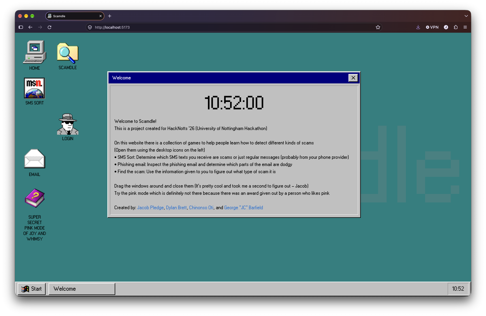
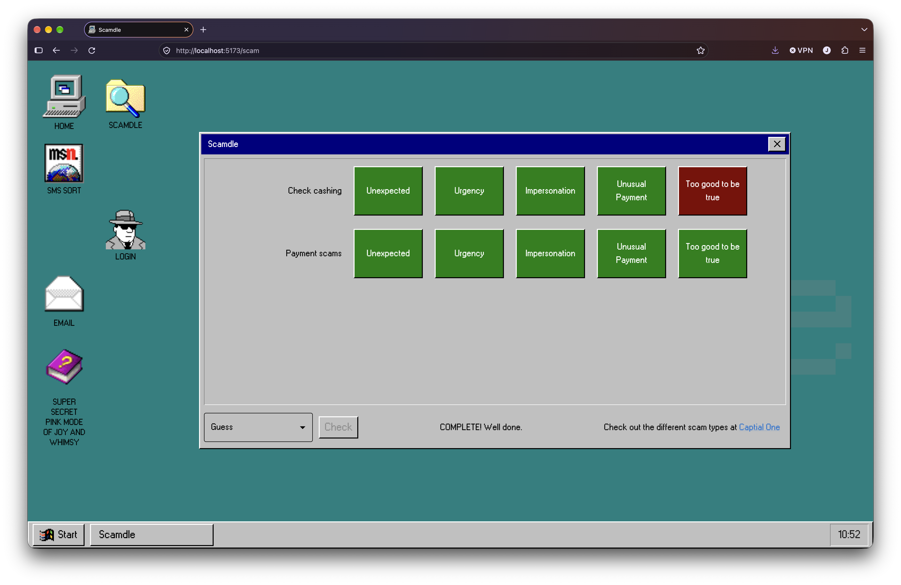
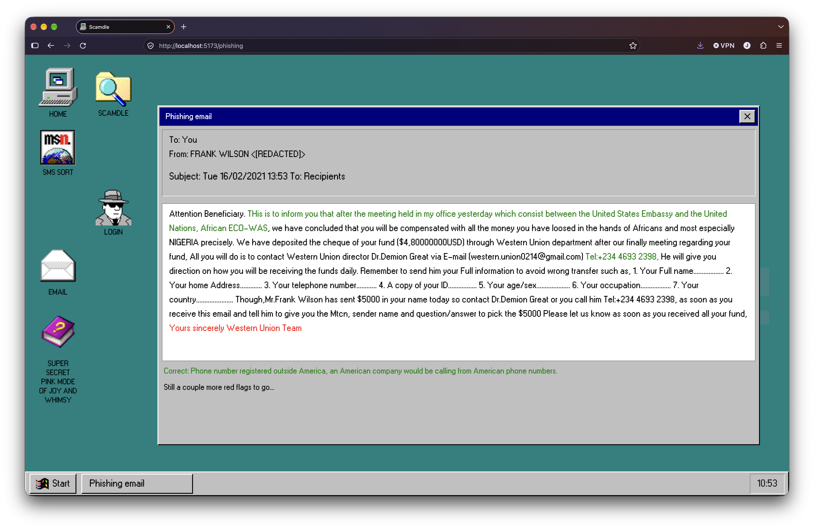
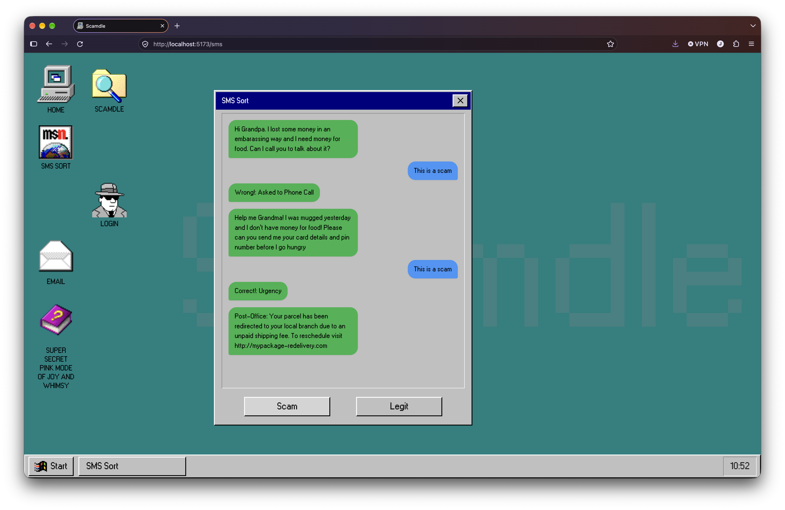
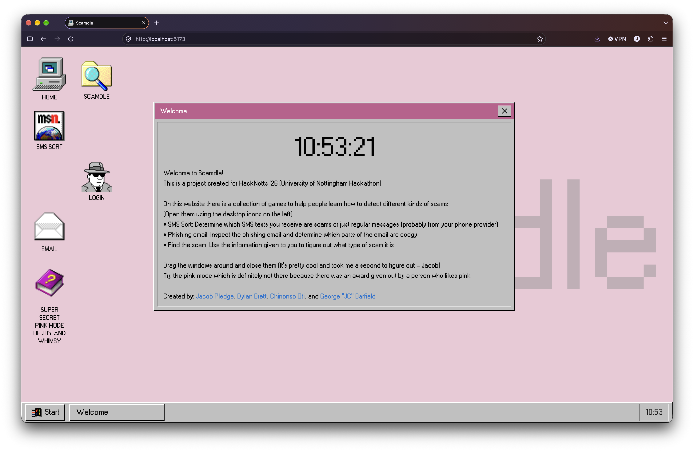
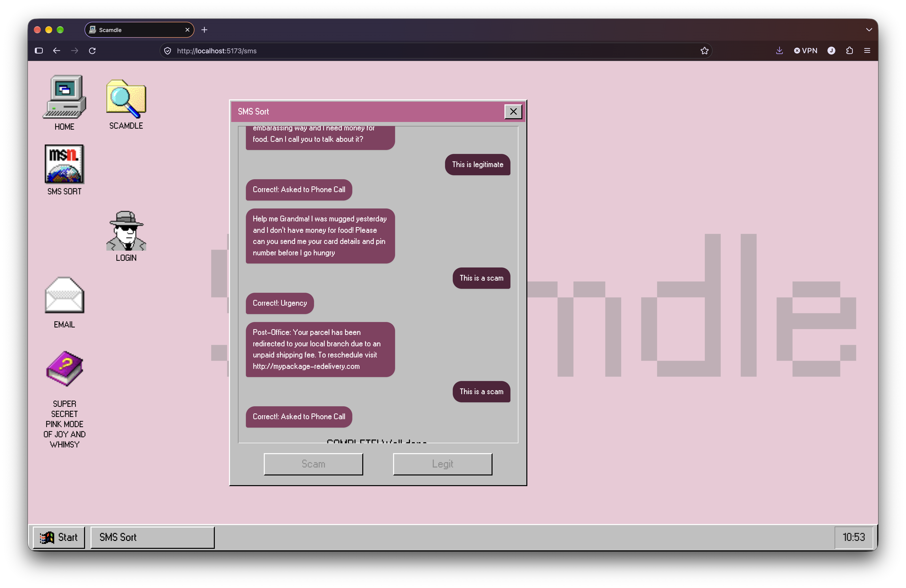

# Scamdle

Scamdle was coded during HackNotts 2026 as a response to the CapitalOne prompt of Helping Customers avoid Digital Payment Scams. Scamdle gamifies this process by targeting common scams in games that can be played daily to help build an understanding of what to look out for in these common scams.

## Gallery
[Demo video](https://youtu.be/eDsMvcbIXjc)

### Home

### Scamdle

The original Scamdle, where you are tasked to identify the scam based on common factors.

### Phishing email
Click on the parts of an email that are 'red flags' when it comes to looking out for scam emails

### SMS Sort
Determining whether or not the SMS message is legit or not

### Optional pink colour scheme
Use the totally secret button to change to a pink theme

# How to run
The react website is set to fetch from localhost, so the backend and frontend should be running on the same machine at the same time. The database entries will show on the website depending on the timestamp, which we have changed to be always the 25th October 2026 (Hackathon day)

#### Backend setup (DO FIRST)
1. <code>cd backend</code> - Get into the back end directory
2. <code>python3 -m venv .venv</code> - create a venv
3. (MacOS specific cmd prompt) <code>source .venv/bin/activate</code> - access venv
4. <code>pip install "fastapi[standard]" "pwdlib[argon2]" sqlalchemy "starlette[full]" pyjwt</code> - Install any packages
5. Delete the CONTENTS of scamdle.db (DO NOT DELETE THE FILE)
6. Run <code>filldb.py</code>
7. (with [uv](https://docs.astral.sh/uv/) installed) <code>uv run fastapi dev routes.py</code> - Run the react server

#### Frontend setup
1. <code>cd frontend</code> - Get into the front end directory
2. <code>npm install</code> - Install any packages
3. <code>npm run dev</code> - Run the react server

# Contributorsgit 

Jacob Pledge - [Github](https://github.com/PledgeJ)

Dylan Brett - [Github](https://github.com/dbrett07)

Chinonso Oti - [Github](https://github.com/chinooti)

George Barfield - [Github](https://github.com/JonCrumbler)
